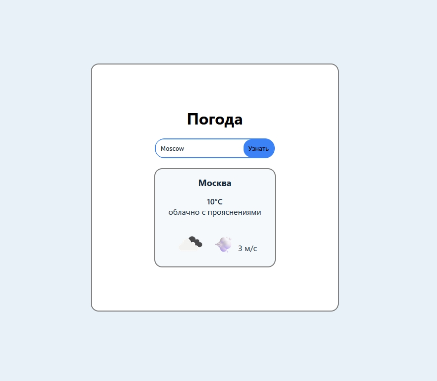

# Weather App

Веб-приложение для просмотра текущей погоды в любом точке мира.

## 🖼 Скриншот

## 🚀 Демо

[Открыть на Layero](https://api-weather.layero.app/)

## ✨ Что умеет

- Поиск погоды по названию города
- Отображение температуры, описания, влажности и скорости ветра
- Иконка погоды от OpenWeatherMap
- Обработка ошибок: город не найден, пустой ввод, цифры в названии
- Состояние загрузки во время запроса

## 🛠 Технологии

- **HTML5** — структура
- **CSS3** — стили, CSS-переменные, `:focus-within`, `flexbox`
- **JavaScript (ES6+)** — основа
- **OpenWeatherMap API** — геокодинг + текущая погода

## 📦 Как запустить локально

1. Скачай папку проекта (или `git clone`).
2. Открой `index.html` в браузере.
3. В `tests.js` замени `API_KEY` на свой ключ с openweathermap.org.