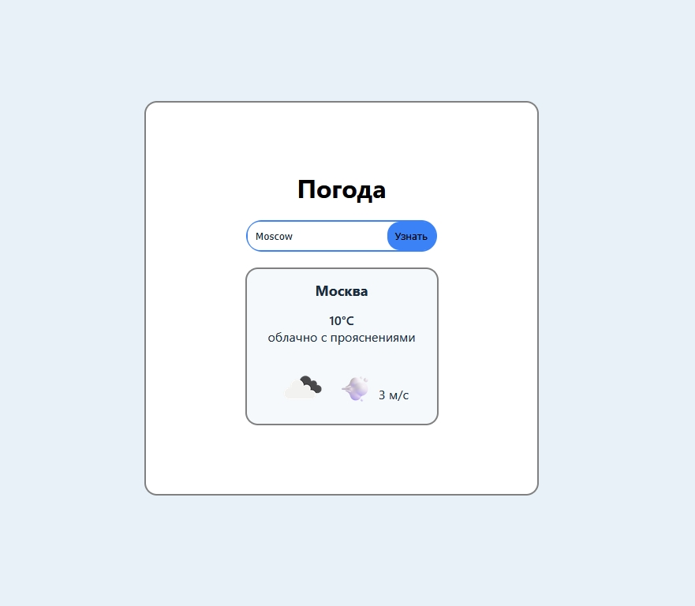

# Weather App

Веб-приложение для просмотра текущей погоды в любом точке мира.

## Скриншот

## Демо

[Открыть на Layero](https://api-weather.layero.app/)

## Что умеет сайт

- Поиск погоды по названию города
- Отображение температуры, описания, влажности и скорости ветра

## Технологии

- **HTML5** - структура
- **CSS3** - стили, CSS-переменные, `:focus-within`, `flexbox`
- **JavaScript (ES6+)** - основа
- **OpenWeatherMap API** - геокодинг + текущая погода
